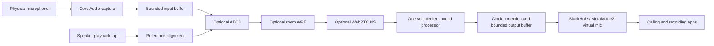

# MetalVoice2 build plan

Prepared November 16, 2026. Target: Apple Silicon, initially the user's M1 Max. Implementation began November 17. Version 0.9 adds LocalVQE joint v1.3 as an Enhanced mode with native GGML CPU inference and causal 48/16 kHz conversion. Selecting it suspends and greys out the separate AEC3 and WPE controls while preserving their saved settings. This mode targets noise and room cleanup using a silent playback reference; it does not run speaker AEC. Listening and live routing qualification remain outstanding. Current behavior and measurements are in [README.md](README.md) and [VERIFICATION.md](docs/VERIFICATION.md); the sections below retain the broader roadmap. Source investigation, algorithm alternatives, and voice-changer provenance are preserved in [RESEARCH.md](docs/RESEARCH.md).

## 1. Product and release scope

Build a native macOS menu bar utility that continuously cleans a selected microphone and presents the result to calling, recording, and streaming applications. Priorities, in order: natural speech, reliable audio, short delay, and low total machine impact. Keep several algorithms available because the preferred balance between suppression and voice character differs by person.

Initial platform decisions:

- Apple Silicon arm64; macOS 15 or newer. This permits Core ML stateful models without a second compatibility implementation. The M1 Max is the first qualification machine; other Apple Silicon chips need their own measurements.
- Swift/AppKit `NSStatusItem` and `NSPopover`, with SwiftUI settings. Set `LSUIElement` so the app works without a Dock icon or persistent window.
- Core Audio HAL/AUHAL for device-specific capture and output; a C++ audio core with a small C interface to Swift.
- Accelerate/vDSP and optimized native CPU libraries for conventional DSP; Core ML for qualified neural models. Metal/MPS kernels only where profiling establishes a useful improvement.
- Entirely local processing. Ship native libraries and model assets; development/export tools do not ship with the app.

Release in two steps:

1. **Usable beta:** native menu app, existing BlackHole output, independent echo/basic suppression controls, at least two qualified enhanced processors, and measured CPU/accelerator choices. Echo now uses AEC3 with a playback reference; Room de-reverb retains the earlier WPE implementation. Live AEC qualification remains outstanding.
2. **Self-contained release:** the same app with a MetalVoice2 virtual microphone, signed installer/update/uninstall flow, and driver recovery. Applications can then select “MetalVoice2 Microphone” directly.

Exact reproduction of Amazon Voice Focus is not a release dependency. The user's voice-changer passthrough with sup1 + sup2 is the listening reference. The published source identifies sup2 as Amazon Voice Focus c20, not an open model that can simply be converted to Metal. See the source links and installed-version qualification in [the research](docs/RESEARCH.md).

## 2. User experience

The menu exposes only controls that affect everyday use:

| Control | Behavior |
| --- | --- |
| Processing | Start/stop; stopping produces silence on the virtual microphone. |
| Microphone | Physical device and channel; remember its stable device UID. |
| Room de-reverb | Independent checkbox, Off by default. Conservative online WPE, no playback reference; 10 ms signal delay. |
| Echo | AEC3, Off by default. Stereo Core Audio tap of the macOS default physical output; System Audio Recording permission required. 8.96 ms algorithm delay plus tap buffer headroom. |
| Basic suppression — Sup1 | Independent WebRTC noise-suppression checkbox, with intensity in settings. |
| Enhanced suppression | Off, RNNoise, DeepFilterNet3, DPDFNet-2, LocalVQE. LocalVQE suspends separate Echo/WPE. |
| Strength | Model-specific attenuation control where supported; clearly label a blend when that is the available mechanism. |
| Bypass / mute | Explicit raw-audio bypass for comparison, and a separate mute control. |
| Status | Processing, muted, recovering, or error; compact input/output meters while open. |

Settings contain output routing, launch at login, saved per-algorithm strength, and an advanced compute preference: Auto, CPU, Neural Engine preferred, or GPU preferred where supported. Ordinary users should not have to choose hardware or tune buffers. Use `SMAppService.mainApp` for login registration and show its actual system status. See [Apple's login-item API](https://developer.apple.com/documentation/servicemanagement/smappservice).

There are no voice-conversion, pitch, Chunk, or Extra controls. Processing cadence comes from the active algorithm and audio device. Keep automatic gain control and hard gating off initially to preserve voice character. Expose no strength slider that merely turns down output volume.

Prototype audition presets are “Light”, “Balanced”, and “Strong”; assign algorithms and strengths only after listening tests. Do not label one algorithm universally best. Save the user's chosen sound and avoid silently switching models when machine load changes.

## 3. Audio architecture



Use mono Float32 at 48 kHz internally for the full-band path. Select one physical input channel explicitly; duplicate mono to the required BlackHole output channels. Add stateful sample-rate conversion when hardware or a model requires a different rate. A 16 kHz model must be presented as a narrower-band option; resampling its result to 48 kHz cannot restore missing high frequencies.

Start by requesting 128- or 256-frame hardware buffers where supported, then read back the actual settings. Adapt callback lengths to each model's exact hop size. WebRTC accepts 10 ms blocks; that is a calling cadence, not total pipeline latency. Feed compatible stages directly, avoiding an extra queued block at every stage.

Use three execution domains:

1. **Hardware callbacks:** transfer samples and timestamps through preallocated single-producer/single-consumer buffers. No locks, allocation, file access, UI work, model loading, inference, or accelerator waits.
2. **Processing:** run bounded conventional DSP on an audio worker. Use an appropriate custom Audio Workgroup for asynchronous real-time DSP. A Core ML model runs on a dedicated serial inference worker with bounded input/output handoff; Core ML is not assumed to provide hard real-time guarantees. Avoid extra worker hops for a CPU-only chain.
3. **Control/UI:** device enumeration, configuration, permissions, model preparation, logging, and low-rate status updates.

Apple documents custom workgroups for asynchronous audio workers in [Audio Workgroups](https://developer.apple.com/documentation/audiotoolbox/adding-asynchronous-real-time-threads-to-audio-workgroups). Joining a workgroup does not make arbitrary blocking code safe.

Each processor advertises sample rate, hop size, measured delay, supported strength controls, state size, reset rules, and available compute backends. Lifecycle: prepare off the audio path → warm up → process consecutive frames with persistent state → reset after discontinuity → release off the audio path. Serialize stateful inference. [Core ML's MLState](https://developer.apple.com/documentation/coreml/mlstate) is available from macOS 15 and requires serialized predictions for shared state.

Capture and virtual output can have different clocks. Track sample/host timestamps and slowly correct drift with a stateful asynchronous resampler. Bound queue occupancy and record underruns, overruns, missed deadlines, and resets. More buffering is not a long-term clock-drift solution.

On a missing device or failed processor, fade to silence, display recovery/error state, and retry outside the callbacks. Never silently expose the raw microphone, repeat stale audio, or accumulate an ever-growing delay. Switching algorithms prepares the next processor separately, aligns output delays, briefly crossfades, then unloads the previous one. This is the only normal interval when two enhanced processors run together.

## 4. Algorithms and integration order

| Processor | Purpose | First integration | Release decision |
| --- | --- | --- | --- |
| WebRTC APM | Sup1-like basic suppression and independent AEC3 | Pinned C++ library with AGC disabled | Core feature; confirm capture and reverse-reference configuration. |
| RNNoise | Small native neural option | Pinned upstream C implementation and selected model | First efficiency candidate; confirm terms of the exact separately distributed weight artifact before bundling. |
| DeepFilterNet3, including low-latency variant | Full-band naturalness/quality option | Upstream native reference, then streaming Core ML export | First acceleration candidate; ship only after preprocessing and streaming parity pass. |
| DPDFNet2 48 kHz HR | Alternative full-band character and suppression | Stateful native inference reference, then Core ML feasibility | Include if it adds audible value within resource limits. |
| SpeexDSP | Classic non-neural alternative | Native C preprocessor | Small optional addition if its sound is useful. |
| GTCRN / UL-UNAS | Compact alternative neural modes | Streaming native model runtime | Later shortlist; standard models use 16 kHz. |

Sources: [WebRTC APM](https://webrtc.googlesource.com/src/+/refs/heads/main/api/audio/audio_processing.h), [RNNoise](https://github.com/xiph/rnnoise), [DeepFilterNet](https://github.com/Rikorose/DeepFilterNet), [DPDFNet](https://github.com/ceva-ip/DPDFNet), [SpeexDSP](https://github.com/xiph/speexdsp), [GTCRN](https://github.com/Xiaobin-Rong/gtcrn), and [UL-UNAS](https://github.com/Xiaobin-Rong/ul-unas). Detailed format, license, and latency caveats are in the research document.

Select at least two enhanced processors for the beta, with RNNoise and DeepFilterNet3 the first pair to qualify. Do not bundle every framework merely to populate a long menu. Keep one enhanced processor loaded during steady operation. Prefer Core ML plus small native libraries in the shipped app; keep ONNX/TFLite in the benchmark tools unless a worthwhile model cannot use the selected runtime. Rust/libDF can remain a reference implementation unless its shipping backend wins the comparison.

Compare each neural processor alone and following mild basic suppression. The user's preferred double suppression is supported, but it should not be forced on everyone: assess quiet speech and consonants carefully. A generic speech denoiser does not necessarily remove other people talking. Apple voice processing is an optional separate comparison, not an open-source algorithm or another stage enabled accidentally.

## 5. Hardware acceleration strategy

The objective is to leave the Mac responsive while audio remains continuous. Accelerator utilization is useful only when it reduces total CPU work, energy, or delay without causing dropouts or harming foreground work.

| Work | Initial placement | Optimization criterion |
| --- | --- | --- |
| Audio I/O, clock tracking, control | CPU | Small deterministic work; no accelerator handoff. |
| AEC, basic suppression, small native models | Optimized ARM CPU code | Measure before considering a port. |
| FFT, windowing, vector operations | Accelerate/vDSP where parity permits | Reduce allocations and memory traffic before changing hardware. |
| Eligible neural model | Core ML; test Neural Engine preference early | Lower CPU/power with sufficient deadline margin. |
| Models or operators benefiting from GPU | Core ML GPU or measured Metal/MPS implementation | Win in complete streaming-pipeline measurements, including under foreground GPU load. |

For each candidate, compare native CPU, Core ML `cpuOnly`, `cpuAndNeuralEngine`, `cpuAndGPU`, and `all`. These settings permit execution units; they do not guarantee that all operators run there. In particular, `all` is OS-selected and “Neural Engine preferred” can include CPU work. Verify placement and fallback with available Core ML profiling tools. See [MLComputeUnits](https://developer.apple.com/documentation/coreml/mlcomputeunits).

Qualify acceleration early, before committing the product to a model:

1. Export exactly one streaming step with fixed tensor shapes and persistent recurrent/convolutional state. Preserve upstream windows, FFT scaling, feature normalization, filter-bank mapping, lookahead, and overlap-add.
2. Compare long, frame-by-frame outputs and state against the upstream reference. Establish a numerical tolerance and a listening baseline before FP16 or graph rewrites.
3. Preload and warm the model away from audio callbacks. Reuse buffers where supported. Measure conversion, feature preparation, inference, postprocessing, and scheduling together.
4. Benchmark idle operation, CPU-heavy work, GPU-heavy work, and power/thermal constraints. Include the cost of waking an otherwise idle accelerator.
5. Select the lowest-impact backend that meets sound and latency requirements. Cache a qualified Auto choice by model, chip, and OS; revalidate after meaningful changes. Do not benchmark continuously in the background.

Do not collect future audio frames to create efficient GPU batches; that directly increases delay. Do not attempt a custom Metal rewrite before the native/Core ML benchmark identifies a specific bottleneck. If conversion or acceleration fails qualification, retain the reference CPU path, record the reason, and try the next eligible model rather than claiming hardware acceleration from an API setting.

## 6. Echo and virtual microphone routing

AEC needs audio actually going to the speakers as its reference. Capture the relevant playback stream with Core Audio process taps, exclude MetalVoice2's virtual-mic output, and align its timing, route, and volume with the microphone stream. Feed the reverse path into APM before processing captured speech. Ask for system-audio capture permission only when configuring echo; microphone access is required for normal processing. See [Apple's Core Audio tap sample](https://developer.apple.com/documentation/coreaudio/capturing-system-audio-with-core-audio-taps).

Test playback alone, local speech alone, and simultaneous speech, including playback-device and volume changes. If the reference disappears, indicate that echo cancellation is unavailable. Echo cancellation is off for the initial headphones-oriented preset. It should not be described as general room dereverberation.

For the beta, write processed samples to the user's existing BlackHole device. Receiving apps select BlackHole as input. Detect missing BlackHole and invalid/feedback-producing routes explicitly. Do not change the system's default microphone or speakers without an explicit user action.

For the self-contained release, implement a minimal AudioServerPlugIn exposing a stable MetalVoice2 input device, with bounded shared-memory transport from the application. Keep all denoising and model runtimes outside `coreaudiod`. If the app is stopped or disconnected, the device returns silence. Validate sample clocks, client format negotiation, reconnects, multi-client access, and audio-server restart recovery. Apple's [Audio Server driver sample](https://developer.apple.com/documentation/coreaudio/creating-an-audio-server-driver-plug-in) is a starting point, not a finished production driver.

Package the driver separately from routine app updates where practical, with signing, notarization, explicit installation, and a complete uninstall path. Using the existing BlackHole installation avoids adding a driver installer to the first prototype. If incorporating BlackHole code or distributing it, resolve its stated [GPL/commercial licensing](https://github.com/ExistentialAudio/BlackHole#license) as part of that packaging decision.

## 7. Performance and quality acceptance

These are proposed engineering targets, not current results. Measure on the M1 Max with the user's USB/wired microphone and a separate recorder receiving the virtual input.

| Area | Target / release evidence |
| --- | --- |
| Sound | User accepts at least one native preset against the current sup1 + sup2 passthrough reference; alternatives offer useful different tradeoffs. |
| Low-latency preset | Aim for ≤50 ms p95 from timestamped capture to virtual-input reception; investigate 20–30 ms as a stretch target. |
| Other presets | Publish measured delay per algorithm; do not hide model lookahead behind a “10 ms” hop label. |
| Processing deadline | p99 chain execution below half the active hop; stretch <2 ms for a 10 ms CPU chain. Track worst cases and misses separately. |
| Lightweight CPU preset | Stretch <5% of one CPU core on average, meaning <50 ms CPU time per second. |
| Memory | Stretch <100 MB resident for the lightweight app/processor; report heavier model and accelerator allocations separately. |
| Stability | Eight-hour continuous run without growing queues or unhandled discontinuities; bounded recovery after sleep, hotplug, and format changes. |
| Foreground impact | Repeat a representative CPU and GPU workload with processing off/on. Prefer profiles with no reproducible slowdown outside measurement variability. |
| Energy | Compare incremental power/energy against identical native bypass and against voice-changer. CPU percentage alone is insufficient. |
| Privacy/offline | Local audio and model execution; no recording or diagnostic audio upload by default; works without a network. |

Use identical source material for fan noise, hum, typing during speech, intermittent impacts, quiet speech, breaths, word beginnings/endings, and nearby conversation. Compare raw, basic-only, neural-only, and combined chains. Align delay and loudness for listening; preserve unaltered samples for objective measurements. Disable receiving-app suppression during controlled comparisons where possible.

Distinguish callback/queue latency, algorithmic delay, and total capture-to-receiver latency. Use speech or broadband probes and cross-correlation; some denoisers suppress isolated impulses. Report p50/p95/p99 and startup separately. Hardware loopback is an additional physical measurement. Bluetooth, conferencing/network buffering, and remote playback remain outside the wired local target.

## 8. Milestones and exit criteria

| Milestone | Deliverable | Exit criterion |
| --- | --- | --- |
| 0 — Baseline and build setup | Pinned dependencies/model manifests, reference recordings, reproducible benchmark harness | Confirm installed voice-changer behavior and capture its preferred sound/resource use. Select full Xcode toolchain. A minimal suppression-only browser harness is optional if needed to isolate the reference, and never ships. |
| 1 — Native transport | arm64 command-line mic → bypass → BlackHole, timestamps, clock correction, counters | Separate recorder verifies latency floor; sustained run has stable queues; unplug/replug and sleep/wake recover. |
| 2 — Model and acceleration feasibility | APM, RNNoise, upstream DFN3/low-latency comparison; first Core ML export; DPDFNet feasibility | At least two useful sound profiles identified; CPU/ANE/GPU paths measured for an eligible model; conversion parity and license provenance recorded. |
| 3 — Usable menu app | Controls, presets, persistent device settings, model switching, mute/bypass, launch at login | Runs with menu closed, remembers choices, does not silently send raw audio, and only active processing consumes steady resources. |
| 4 — Speaker echo | Playback tap, AEC3 reference alignment, reference-loss behavior | Echo works under tested routing and double-talk conditions; permission denial and route changes produce clear state. |
| 5 — Beta qualification | Signed/notarized BlackHole-based build and benchmark report | User accepts sound; latency/resources disclosed; eight-hour soak, foreground-load, offline, and device recovery checks pass. |
| 6 — Integrated microphone | Thin driver, installer/uninstaller, update and reconnect support | Receiving apps see a stable MetalVoice2 input without separately installing BlackHole; app/driver failures produce silence and recover predictably. |

Treat milestones 1 and 2 as the first implementation work. They resolve the two expensive uncertainties: reliable low-delay routing and whether a preferred neural model benefits from Apple acceleration. UI polish and driver distribution follow those results.

The development environment selects Command Line Tools rather than full Xcode. The baseline uses SwiftPM and a script to create the app bundle, so full Xcode is not required for this milestone. Profiling/distribution tooling may require additional setup later.

## 9. Repository and build organization

```text
MetalVoice2.xcodeproj/    Application, signing, and integration targets
App/                    Status item, popover, settings, lifecycle
AudioCore/              HAL transport, clocks, bounded queues, resampling
Processors/            C ABI, WebRTC/RNNoise adapters, processor contracts
ModelBackends/         Selected Core ML/native inference adapters
Models/                Shipped assets and revision/hash/license manifest
Tools/Bench/            Offline audition and live latency/resource harness
Tools/ModelExport/      Reproducible conversion scripts; development only
Tests/                  Streaming, drift, recovery, and numerical parity
Driver/                 Virtual microphone; added in milestone 6
docs/                   Research, benchmark reports, architecture decisions
```

Use Swift packages for modular app code and native bridge targets; pin third-party native builds and model hashes. Maintain model manifests with upstream revision, model variant, preprocessing contract, sample rate/hop, measured delay, conversion version, supported compute modes, and license/notices. Avoid downloading arbitrary latest assets during release builds.

Tests should protect audio behavior: streaming output independent of callback partitioning, bounded drift correction, state reset after discontinuities, sample-scale correctness, no NaNs/clipping, parity with upstream model output, and recovery from worker/device failures. Use a real-device integration run for clocking, latency, and permissions; offline unit tests cannot establish those properties. Run profiling and allocation checks on the actual render path.

The build is complete when the selected presets sound acceptable, run continuously with measured low impact, and reliably appear as a microphone in other apps. The final self-contained release also includes the integrated device and its installation lifecycle.
