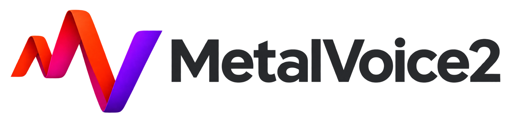

<h1>
  <a href="Resources/Brand/MetalVoice2-logo.png">
    <picture>
      <source media="(prefers-color-scheme: dark)" srcset="docs/assets/MetalVoice2-logo-on-white.jpg">
      
    </picture>
  </a>
</h1>

<a href="Resources/Brand/AppIcon.icns"></a>

MetalVoice2 is a native Apple Silicon menu bar app for microphone cleanup and optional real-time voice conversion. Audio flows from your microphone through the enabled processors to a virtual microphone for calls or recording. All processing runs locally.

## Install and set up

Download the [v2.0-beta Apple Silicon ZIP](https://github.com/maxhabra/MetalVoice2/releases/tag/v2.0-beta), unzip it and move **MetalVoice2.app** to Applications. The ZIP includes the optional `setup_voice_runtime.sh` for voice conversion.

You need macOS 15 or later and a **virtual audio driver**, such as [BlackHole 2ch](https://github.com/ExistentialAudio/BlackHole) or [VB-CABLE](https://vb-audio.com/Cable/). Building from source requires Command Line Tools with Swift 6, Rust/Cargo and Python 3. The first build downloads dependencies.

```sh
./scripts/build.sh
open build/MetalVoice2.app --args --show
```

1. In **Microphone**, turn on **Enable** and grant microphone access. Choose your physical input, channel and virtual output. Set the input to **48,000 Hz** in Audio MIDI Setup for cleanup or voice conversion.
2. In your calling or recording app, select that same virtual device as its microphone. With BlackHole, choose **BlackHole 2ch** in both apps.
3. Each tab has its own **Enable** and **Enable at launch**. Turn both tabs off to stop streaming. To open MetalVoice2 at login, add it under **System Settings → General → Login Items & Extensions**.

The menu bar **M lights blue** for the microphone stage and **V lights violet** for voice conversion. **Red means muted** across both tabs. Right-click the icon for quick controls. Hover over a setting for help, including when it is greyed out.

## Voice Changer · v2.0-beta

Conversion runs **after microphone cleanup** in a local CPU worker using ContentVec, a selectable pitch estimator and an RVC decoder. For voice conversion, run `bash setup_voice_runtime.sh` from the extracted ZIP folder, or `./scripts/setup_voice_runtime.sh` from the source checkout. Microphone cleanup works independently.

1. Under **Voice Changer**, turn on **Enable** and import a pitch-guided RVC v1 or v2 inference `.pth`. The app remembers its location. Keep the file in place. If you have a matching `.index`, use **Attach .index…**. A same-name index alongside the model is picked up on first import.
2. For shared models, the app checks nearby VCClient folders. If prompted, use **Model assets…** to select the `modules` folder containing `contentvec/contentvec-f.onnx`. The default RMVPE estimator also uses `rmvpe/rmvpe_20231006.onnx`.
3. Adjust **Pitch** in semitones and **Index blend** to set the contribution of the attached index. **Apply settings** saves edits per voice and restarts conversion. **Cancel** restores the saved values. **Enable** lets you bypass conversion while keeping the voice selected.

| Voice setting | What to adjust |
|---|---|
| F0 estimator | **RMVPE (ONNX)** tracks input pitch with a neural model. **Harvest** tracks it from speech harmonics using the bundled WORLD algorithm. Select one and click **Apply settings** to save it for that voice. |
| Chunk | Fresh audio collected per conversion. Lower values reduce waiting time but give the worker less time to finish. |
| Extra history | Past audio used as context. Increasing it adds inference work without waiting for that much new audio. |
| Noise gate / Gate hold | Set the input threshold in dBFS. If quiet syllables get cut off, increase hold in milliseconds. The input meter shows the applied gate. |
| High-pass / Low-pass | Set the lower and upper frequency cutoffs on the converted voice. |

## Choose a processor

Processing order is **Echo → Room de-reverb → WebRTC → Enhanced**. Each stage is optional. Select one Enhanced model at a time. Delay is the signal delay added by that stage at 48 kHz. Compute p99 is how long 99% of the measured 10 ms blocks took to process on an M1 Max.

| Control | What it does | Added delay | Compute p99 |
|---|---|---:|---:|
| Echo · WebRTC AEC3 | Removes Mac speaker playback picked up by the mic, using a stereo playback reference | 8.96 ms¹ | 0.24–0.38 ms² |
| Room de-reverb · WPE | Softens late reflections of your own voice using the mic alone | 10 ms | 0.68 ms² |
| WebRTC · Low to Very high | Low-cost noise suppression with four strengths | 6.96 ms | 0.010–0.045 ms |
| RNNoise | Lightweight recurrent speech denoiser, native ARM CPU | 20 ms | 4.42 ms |
| DeepFilterNet3 | Full-band neural noise suppression, Core ML with native fallback | 30 ms | 2.41 ms |
| DPDFNet-2 | Full-band dual-path denoiser, 48 kHz HR model on Core ML CPU | 50 ms | 4.43 ms |
| LocalVQE | Joint noise and room cleanup, 16 kHz speech, two GGML CPU threads | 34 ms | 31.08 ms³ |

¹ Echo also reserves one playback tap buffer. Enable **System Audio Recording** when prompted and send the calling app's playback to the Mac's default physical output. LocalVQE disables Echo and Room de-reverb while selected and restores their settings when you switch back. Its playback reference is silent, so use AEC3 when you need speaker echo cancellation.

² AEC3 and WPE timings come from their respective synthetic tests. The other timings come from the post-fix offline speech run below. They include OS scheduling. ³ LocalVQE exceeded the 10 ms processing budget at p99 in this run. An earlier dedicated test measured 8.06 ms p99. Scheduling load matters for this model. [Timing protocol](docs/V1_REVIEW.md#reproduce-the-quality-table) · [Earlier measurements](docs/VERIFICATION.md)

**Audio path latency** measures capture to scheduled virtual output using Core Audio timestamps. It includes enabled filters and transport buffering. The receiving app and network add their own delay. **Details → Copy report** includes device rates, queue depth, underruns and processing time.

## Speech quality and intelligibility

**Published research.** Rika, Sapir and Gus tested these models on the same 324 recordings spanning 12 languages and nine noisy environments at 0, 5 and 10 dB SNR. These are the authors' results from their multilingual test set. Higher PESQ means better predicted speech quality. Higher STOI means better predicted intelligibility. STOI is shown on a 0–100 scale. [DPDFNet paper, Table 1, accepted version](https://arxiv.org/html/2512.16420v3#S4.T1)

| Model in the paper | PESQ ↑ | STOI × 100 ↑ |
|---|---:|---:|
| Noisy input | 1.32 | 83.2 |
| RNNoise | 2.36 | 88.5 |
| DeepFilterNet3 | 2.76 | 90.5 |
| DPDFNet-2 | **3.14** | **92.6** |

**MetalVoice2 measurements.** Each native mode processed the same 40 held-out VoiceBank+DEMAND utterances, balanced across two speakers, five noises and four SNRs. Each clip starts with fresh model state. Compare rows *within* each table because the recordings and model variants differ. This local test measures additive noise suppression. Room reflections and playback echo need different test signals. [Method and reproduction](docs/V1_REVIEW.md#reproduce-the-quality-table) · [Per-clip results](docs/benchmarks/voicebank40.csv)

| Native mode, used alone | Wideband PESQ ↑ | STOI × 100 ↑ |
|---|---:|---:|
| Noisy input | 1.97 | 92.1 |
| WebRTC Low | 2.36 | 91.5 |
| WebRTC Medium | 2.45 | 90.4 |
| WebRTC High | 2.41 | 89.2 |
| WebRTC Very high | 2.35 | 88.3 |
| RNNoise | 2.14 | 88.0 |
| DeepFilterNet3 | 2.11 | 85.1 |
| DPDFNet-2 | **2.99** | **93.4** |
| LocalVQE | 2.30 | 91.4 |

**WebRTC Medium** is a good starting point for low delay. **DPDFNet-2** led both local quality measures and adds 50 ms of signal delay. Stronger WebRTC settings reduced intelligibility on this sample. Use **Room de-reverb** or try **LocalVQE** if your main complaint is a hollow room sound.

## Verification

Run `./scripts/test.sh` for the offline suite. For a live cleanup benchmark with BlackHole 2ch, quit the menu app and run `./scripts/benchmark.sh 60 off --enhanced dpdfnet2` after granting microphone access. Local builds are ad-hoc signed. [v2.0 review and voice timings](docs/V2_RC_REVIEW.md) · [Hardware test guide](docs/BASELINE.md)

## License

MetalVoice2's original code is licensed under the GNU General Public License, version 3 only (`GPL-3.0-only`). The app includes the license in `Contents/Resources/Licenses/MetalVoice2/LICENSE`. Bundled third-party code and models retain their upstream terms. [Full license](LICENSE) · [Third-party notices](ThirdParty/)

MetalVoice2 embeds the official RNNoise pretrained weights. Their redistribution terms remain an open question upstream. [RNNoise model provenance](ThirdParty/RNNoise/README.md#notices-and-model-provenance) · [Upstream licensing question](https://github.com/xiph/rnnoise/issues/284)
