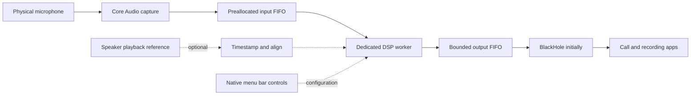

**MetalVoice2 — research and implementation plan**

Research archive. The current product scope, architecture, and implementation sequence are defined in [PLAN.md](../PLAN.md); earlier implementation suggestions below are retained as research context.

Prepared November 16, 2026. Target hardware: the user's M1 Max. Exact macOS version remains to be confirmed before selecting the deployment target. The user confirmed that voice-changer's sup1 + sup2 sounds good in passthrough mode, so voice conversion is unnecessary.

Build a small native menu bar application that cleans microphone audio and sends it to a virtual microphone. Start with the existing BlackHole route shown in the screenshot. The clarified product direction is multiple selectable native processors: independent Echo and basic suppression checkboxes, plus an enhanced-denoiser selector. Use the user's preferred sup1 + sup2 sound as a comparison reference; exact Voice Focus reproduction is not a requirement. Include a measured Metal/Core ML experiment, while keeping efficient CPU backends available.

This is an implementation plan, not a working application or benchmark report. All performance budgets below are proposed acceptance targets.

**What the voice-changer controls actually do**

The published source maps the controls as follows:

| Control | Verified implementation | Native equivalent or implication |
| --- | --- | --- |
| echo | `getUserMedia({ audio: { echoCancellation: ... } })` | Browser-selected acoustic echo cancellation. WebRTC AEC3 is a candidate native implementation, but the browser/OS may select a different implementation. |
| sup1 | `getUserMedia({ audio: { noiseSuppression: ... } })` | Browser-selected suppression. Native WebRTC Audio Processing Module (APM) is the closest controllable starting point; a boolean constraint does not identify an exact algorithm or aggressiveness. |
| sup2 | `VoiceFocusDeviceTransformer.create({ variant: "c20" })` from `amazon-chime-sdk-js`; its audio node is inserted when `noiseSuppression2` is enabled | Amazon Voice Focus, a separate neural suppressor. This is not RNNoise or DeepFilterNet. |

The UI mapping is in [QualityArea](https://github.com/w-okada/voice-changer/blob/d8ef15799470193f7c8176ef471245753a656626/client/demo/src/components/demo/components2/102-1_QualityArea.tsx#L99). The capture constraints, explicit `autoGainControl: false`, c20 selection, and node connections are in [VoiceChangerClient](https://github.com/w-okada/voice-changer/blob/d8ef15799470193f7c8176ef471245753a656626/client/lib/src/VoiceChangerClient.ts). Its [package manifest](https://github.com/w-okada/voice-changer/blob/d8ef15799470193f7c8176ef471245753a656626/client/lib/package.json) declares Amazon Chime SDK JS `^3.20.0`.

The intended order is microphone capture with browser processing → input gain → optional Voice Focus → conversion worklet/server → output. Suppression therefore does not require RVC, pitch extraction, a Python server, or the conversion model. The screenshot has echo off and both suppressors on; use that as the initial preset. Keep gain control off when establishing parity, and inspect the effective settings because SDK/browser behavior can affect them.

There is one important provenance limit: the screenshot is **2.0.78-beta mac**. The inspected public `master` commit is `d8ef15799470193f7c8176ef471245753a656626`; the public [v.2 tree](https://github.com/w-okada/voice-changer/tree/bec5bd04d1ba081dd3c60b274de3f9132d443d17) contains documentation rather than client/server implementation. The table is verified for published source, not yet independently verified against the installed 2.0.78 bundle. Inspect that bundle's client assets and effective runtime settings during the first milestone. The confirmed passthrough result is the behavioral reference regardless of source differences.

**Why latency can improve**

At 48 kHz, 2,400 samples are 50 ms and 3,840 samples are 80 ms. However, adding those numbers is not a reliable end-to-end latency calculation. The published [worklet node](https://github.com/w-okada/voice-changer/blob/d8ef15799470193f7c8176ef471245753a656626/client/lib/src/client/VoiceChangerWorkletNode.ts#L282) accumulates input chunks before sending them. Published [RVC processing](https://github.com/w-okada/voice-changer/blob/d8ef15799470193f7c8176ef471245753a656626/server/voice_changer/RVC/RVC.py#L95) adds Extra to a rolling history window, pads missing history, and crops output. Extra increases conversion work/context; it is not simply an instruction to wait for 80 ms of future audio. Passthrough and the installed v2 release need their own measurements.

Removing conversion eliminates its batching, transport, model execution, and crossfade machinery. A native APM implementation accepts 480 samples per channel at 48 kHz, or 10 ms per call. That is its processing cadence, not its complete latency. Window overlap, model lookahead, sample-rate conversion, I/O buffers, and virtual-device queues still count. See the [WebRTC APM API](https://webrtc.googlesource.com/src/+/refs/heads/main/api/audio/audio_processing.h).

Measure latency at two boundaries: captured microphone samples → samples received through BlackHole by a separate recorder, and physical input → receiving application when loopback equipment is available. Timestamp and measure each internal queue. Report steady-state median, p95 and p99 separately from startup, and compare against bypass with identical devices. Use broadband speech/probes and cross-correlation; a suppressor may erase an isolated impulse.

**The exact sup2 sound and a native Metal app are separate engineering questions**

Amazon documents Voice Focus's browser implementation as Web Audio/AudioWorklet/WebAssembly, with SIMD acceleration and downloaded model assets. c20 is a complexity tier. Those facts do not provide a ready-to-convert Core ML model. I did not find a supported standalone native macOS SDK or exportable source weights for this processor in the reviewed sources. The Apache-2.0 JS integration does not by itself establish the distribution terms of every downloaded asset. Record supported deployment and asset terms before shipping a bundled compatibility backend. See [AWS's Voice Focus guide](https://github.com/aws/amazon-chime-sdk-js/blob/main/guides/09_Amazon_Voice_Focus.md).

An older AWS article describes a Linux shared library inside a Voice Focus AMI, but the article now explicitly says that offering became unavailable in August 2025. It is not a native macOS solution. See [AWS's AMI update](https://aws.amazon.com/blogs/business-productivity/using-amazon-voice-focus-ami-to-reduce-noise-in-audio/).

Use a minimal browser reference pipeline first: microphone with matching constraints → Voice Focus c20 → selected BlackHole output. Remove the conversion server/worklets and all voice-conversion UI. Use the same browser engine as the installed client when possible. This prototype tests how much improvement comes purely from removing conversion infrastructure. It remains a browser/WASM experiment; do not call it Metal accelerated or promise that WKWebView will reproduce Chromium behavior. Verify background scheduling, output-device selection and actual sup1 activity. A native shell alone does not solve those issues.

For the final native product, compare open native processors to that reference. RNNoise, DeepFilterNet and the other candidates below are **alternative sup2 implementations**, not ports of Amazon Voice Focus. Offer several acceptable sound profiles rather than forcing all users onto one model. Record differences from the Voice Focus reference honestly; a supported Voice Focus integration can remain optional future research.

**Processors worth evaluating**

| Candidate | Role in the plan | Main tradeoff |
| --- | --- | --- |
| Native WebRTC APM | sup1-like base; optional AEC3 | Small processing blocks and explicit controls; reproducing a browser's exact configuration takes investigation. |
| Current upstream RNNoise, normal and little models | First native neural candidate | Native C and 48 kHz audio; quality must be tested against Voice Focus. |
| Official DeepFilterNet3 and its low-latency model | Full-band quality contender and Core ML experiment | More integration work; preserve exact preprocessing and streaming state. |
| DPDFNet2 48 kHz HR; larger variants only if justified | Additional full-band quality contender | Stateful ONNX/TFLite models; higher arithmetic cost than the smallest candidates. Benchmark before enabling larger variants. |
| Apple voice processing | Cheap native comparison baseline | System-managed behavior and controls; validate USB input/virtual output routing and avoid stacking it accidentally with APM. |
| GTCRN | Experimental efficiency contender | Very small, but the supplied inference path is 16 kHz, so the standard model reduces bandwidth. |
| UL-UNAS | Compact alternative for the expanded selector | MIT project with a streaming ONNX implementation; standard model is 16 kHz. Validate waveform streaming, not just cached neural layers. |
| SpeexDSP preprocessor | Optional classic, non-neural mode | Small native C implementation with attenuation controls; listen for artifacts at aggressive settings. |
| DTLN | Lower-priority additional sound profile | MIT code with ONNX/TFLite exports; standard model is 16 kHz and the author documents 32 ms input-output model delay. |

Use current [RNNoise](https://github.com/xiph/rnnoise/blob/main/README), not an assumption based on the 2018 demo. Its current [frame definitions](https://github.com/xiph/rnnoise/blob/main/src/denoise.h) specify 480-sample hops and a 960-sample window, and its [processing code](https://github.com/xiph/rnnoise/blob/main/src/denoise.c#L457) includes delayed spectra. Measure the pinned version's delay instead of claiming that a 10 ms call means 10 ms total latency. Preserve the native API's expected sample scaling when bridging normalized Core Audio floats.

[DeepFilterNet](https://github.com/Rikorose/DeepFilterNet) supports 48 kHz, provides native Rust processing, and licenses code and model weights under MIT/Apache-2.0. The [official models directory](https://github.com/Rikorose/DeepFilterNet/tree/main/models) includes `DeepFilterNet3_ll_onnx.tar.gz`; inspect its configuration and validate its delay rather than inferring it from the filename. Compare upstream native output before attempting Core ML conversion.

Apple describes its processing capabilities in [What's new in voice processing](https://developer.apple.com/videos/play/wwdc2023/10235/). [GTCRN's official implementation](https://github.com/Xiaobin-Rong/gtcrn) reports 48.2K parameters and 33 MMAC/s, but its [inference example](https://github.com/Xiaobin-Rong/gtcrn/blob/main/infer.py) requires 16 kHz. Its published comparison uses RNNoise (2018), not necessarily current RNNoise. [UL-UNAS](https://github.com/Xiaobin-Rong/ul-unas) now includes a streaming ONNX implementation. These are candidates, not evidence that they will sound better on this microphone.

[DPDFNet](https://github.com/ceva-ip/DPDFNet) extends DeepFilterNet2 with dual-path recurrent blocks and publishes 8, 16 and 48 kHz models. The 48 kHz HR two-block model is the first variant to compare for this application; the eight-block variant is a separate quality/performance experiment. Both the project and the author's [model repository](https://huggingface.co/Ceva-IP/DPDFNet) state Apache-2.0. Use its stateful model through a native runtime; its Python demo does not need to ship. Its attenuation-limit control is relevant to preserving some ambience and reducing the overprocessed effect. Measure the actual pinned model's delay, including neural lookahead and spectral alignment; do not interpret frame hop or first returned buffer as end-to-end latency.

The [GTCRN license](https://github.com/Xiaobin-Rong/gtcrn/blob/main/LICENSE) and [UL-UNAS license](https://github.com/Xiaobin-Rong/ul-unas/blob/main/LICENSE) are MIT. The latter's [streaming example](https://github.com/Xiaobin-Rong/ul-unas/blob/main/ulunas_onnx/README.md) explicitly requires 16 kHz. Resampling these standard models back to 48 kHz does not recover discarded frequencies above 8 kHz. Treat that bandwidth limit separately from denoising artifacts when comparing naturalness.

[SpeexDSP](https://github.com/xiph/speexdsp) uses a BSD-style license and supplies a configurable [noise-suppression preprocessor](https://www.speex.org/docs/manual/speex-manual/node7.html). [DTLN](https://github.com/breizhn/DTLN) provides streaming ONNX and TFLite examples; its documented rate and delay make it a lower-priority addition rather than the first low-latency full-band choice. Apple voice processing is an optional platform baseline, not an open-source algorithm.

RNNoise's code is BSD-3-Clause, but separately downloaded pretrained weight archives currently have [unanswered upstream licensing clarification requests](https://github.com/xiph/rnnoise/issues/284). Verify the exact selected artifact's terms before bundling it; the issue is an unresolved clarification, not a finding that RNNoise is unusable. Record source revisions, model hashes, licenses and notices for every shipped backend. DeepFilterNet explicitly covers both code and model weights, while DPDFNet explicitly labels its model distribution Apache-2.0.

**Selectable processing controls**

The product should expose these independent controls:

- Echo cancellation: WebRTC AEC3 on/off, available when a valid playback reference exists.
- Basic suppression (Sup1): WebRTC NS on/off, with optional Low/Moderate/High intensity. This is a native counterpart to the browser feature, not a promise of identical browser processing.
- Enhanced suppression: Off, RNNoise, DeepFilterNet3, DPDFNet2, and later GTCRN/UL-UNAS. A classic SpeexDSP choice can live in an advanced list.
- Strength: a processor-appropriate attenuation limit or a carefully aligned blend, with conservative presets for preserving voice character. It must not merely reduce output volume.
- A/B bypass: compare at matched loudness and aligned delay. Keep mic/output selection and launch at login in the same small settings interface.

Processing order is microphone → optional AEC → optional basic NS → one selected enhanced processor → output. Keep basic NS optional when a neural processor is active: stacking two suppressors can remove more noise but can also damage quiet speech or consonants. Include basic-only and neural-only comparisons. Keep AGC and a hard noise gate off by default unless separately requested.

Only the selected enhanced processor stays loaded and running during normal operation. Load and warm a newly selected processor off the hardware audio thread, align its output delay, crossfade briefly, then release the previous processor. Provide per-backend sample rate, frame size, measured delay, strength capabilities and state-reset requirements through a shared processor interface. For 16 kHz models, use stateful resampling and explicit rate conversion at the boundaries; do not force every model into the same native frame geometry.

For the user's naturalness preference, compare mild WebRTC-only, reduced-strength RNNoise, and attenuation-limited DeepFilterNet3 first. Include DPDFNet as an additional full-band candidate and GTCRN/UL-UNAS as alternatives for different voices and noise conditions. These are proposed audition priorities, not results from listening tests on the user's voice.

**What to take from MetalVoice**

Keep its product idea: a menu bar interface with input/output selection. Build a fresh audio core. At inspected commit `f0371302c97a1f1c0402860c6f3e68d3690206bb`, [AudioModel.swift](https://github.com/Ghostkwebb/MetalVoice/blob/f0371302c97a1f1c0402860c6f3e68d3690206bb/Sources/Core/AudioModel.swift#L176) invokes DSP directly from `AVAudioSourceNode`'s render callback and acquires diagnostic locks. Its [ring buffer](https://github.com/Ghostkwebb/MetalVoice/blob/f0371302c97a1f1c0402860c6f3e68d3690206bb/Sources/Core/AudioProcessing/RingBuffer.swift) also takes locks.

The [DSP](https://github.com/Ghostkwebb/MetalVoice/blob/f0371302c97a1f1c0402860c6f3e68d3690206bb/Sources/Core/AudioProcessing/DeepFilterNetDSP.swift#L260) allocates/shifts arrays and invokes synchronous Core ML prediction along that path. It uses a Hann window and custom triangular ERB filters, whereas [upstream libDF](https://github.com/Rikorose/DeepFilterNet/blob/main/libDF/src/lib.rs#L105) uses its own Vorbis window and ERB-band construction. These differences warrant parity testing against the custom model's training/export assumptions. They are not proof of the cause of the user's poor results, nor grounds to reject DeepFilterNet itself.

MetalVoice sets Core ML `computeUnits = .all`. Apple defines that as allowing the OS to choose among CPU, GPU and Neural Engine; it does not guarantee Neural Engine execution. See [MLComputeUnits](https://developer.apple.com/documentation/coreml/mlcomputeunits). Avoid inheriting unmeasured “zero latency” or processor-placement claims.

**Native architecture**



Use Swift/AppKit for an `NSStatusItem` and a small settings window; SwiftUI can provide the settings view. Use C/C++ for the real-time boundary, atomic single-producer/single-consumer FIFOs, frame adaptation, and the WebRTC/RNNoise bridge. Expose a small C interface to Swift. Evaluate libDF through a native bridge only if it wins the quality comparison. No browser, Python interpreter, model training environment, or network service in the native runtime.

Start with mono Float32 at 48 kHz. Request 128- or 256-frame Core Audio I/O buffers when supported, and read back actual device settings. Collect exact 480-sample frames for APM/RNNoise independently of hardware callback sizes; other backends declare their own rate and frame geometry. Keep each processor's history alive across calls and pass stages directly into each other; do not insert a separate 10 ms queue between suppressors.

Use Core Audio HAL/AUHAL for device-specific capture and output, with stable device UIDs and sample/host timestamps. The hardware callbacks only transfer samples through preallocated buffers and update atomics. Run DSP, especially Core ML inference, on a dedicated worker with bounded work and a measured scheduling strategy. Investigate joining the applicable Audio Workgroup for auxiliary real-time processing. Keep allocation, locks, file I/O, model loading, UI work, and GPU waits out of hardware callbacks.

The physical input and virtual output may have different clocks even when both say 48 kHz. Implement timestamp-based drift tracking and a stateful asynchronous sample-rate converter, or validate an aggregate-device clocking arrangement. A bigger FIFO is not a drift solution. Bound queue occupancy, detect overruns/underruns, and count every discontinuity. On processing failure, mute with a visible error by default; explicit bypass can provide raw audio. Never silently accumulate seconds of audio or repeat stale frames.

Expose power, input device/channel, output device, the independent Echo/basic suppression controls and enhanced-processor selector described above, strength, bypass, and launch at login. Keep input/output meters low-frequency and active primarily while the menu is open. Include recovery after sleep/wake, device removal, and format changes. Avoid background dashboard animation or high-frequency logging.

For v1, write to the existing BlackHole device and have receiving apps select it as their microphone. A Swift app does not become a system microphone merely by processing audio. A later self-contained release can implement a thin AudioServerPlugIn with shared-memory transport, keeping neural processing outside `coreaudiod`. Apple's [virtual audio driver documentation](https://developer.apple.com/documentation/coreaudio/creating-an-audio-server-driver-plug-in) is the starting point. Treat installation, signing, updating and crash recovery as their own milestone. If incorporating or distributing BlackHole code, account for its [stated GPL/commercial licensing](https://github.com/ExistentialAudio/BlackHole#license); the initial prototype can use the user's existing installation.

**Echo needs an actual playback reference**

AEC cancels sound from the Mac's speakers that re-enters the mic. It is not general room dereverberation or headphone active noise cancellation. Keep echo off initially, matching the screenshot. With headphones it is usually unnecessary.

For speaker use, feed WebRTC AEC3 the relevant playback stream, aligned to capture timestamps, then process the microphone before neural suppression. The reference is the audio going to speakers, not the cleaned microphone being sent to BlackHole. A system-wide utility must capture other applications' playback as well as its own. On supported macOS versions, investigate Core Audio process taps, exclude MetalVoice2's own output, and handle routing, playback volume, delay, and clock drift. Apple's [tap sample](https://developer.apple.com/documentation/coreaudio/capturing-system-audio-with-core-audio-taps) requires macOS 14.2 or later and system-audio capture permission.

Test far-end-only playback, near-end speech, and simultaneous speech. If reference capture is unavailable, show echo cancellation as unavailable/off instead of suggesting it is working. Compare Apple voice processing separately if desired; do not assume it is a drop-in AEC for arbitrary routing. During quality evaluation, disable receiving-app suppression where possible so processing is not unknowingly doubled.

**Metal and Neural Engine optimization on M1 Max**

Keep control logic, I/O, AEC and small DSP operations on CPU initially. Benchmark native optimized CPU execution against Core ML `.cpuOnly`, `.cpuAndGPU`, `.cpuAndNeuralEngine`, and `.all` for a model whose graph and weights are available. GPU submission, synchronization, tensor conversion and wakeup costs can outweigh arithmetic savings for a small sequential workload; this is a hypothesis to measure on M1 Max, not a claim that CPU always wins.

For a Core ML contender, export one streaming step with explicit persistent convolution/recurrent state and fixed tensor shapes. Match upstream feature normalization, spectral scaling, ERB mapping, windowing, padding, lookahead and overlap-add before optimizing. Validate frame-by-frame output and state against the upstream implementation on long recordings. Then try FP16 and inspect actual execution placement and fallback in Instruments. Prewarm off the audio callback and reuse tensor storage.

Only consider custom Metal/MPS kernels after profiling identifies an expensive operation and a credible latency/energy win. Do not batch future frames to improve GPU throughput: that trades away the latency objective. Select the backend using quality, p99 timing, energy and contention results, including a GPU-heavy foreground workload. Metal acceleration remains a concrete experiment in the plan, not an assumed performance benefit.

**Proposed acceptance targets**

| Measure | Initial goal on M1 Max |
| --- | --- |
| Sound | At least one native preset satisfies the user's naturalness/noise preference against the passthrough sup1 + sup2 reference; additional processors may intentionally offer different tradeoffs. |
| Steady-state latency | Aim for ≤50 ms p95 from timestamped capture to receiving virtual-input samples with wired/USB devices; investigate 20–30 ms for the fastest acceptable chain. Exact model delays can change feasibility. |
| DSP deadline | For a 10 ms hop, aim for <2 ms p99 processing time and substantial scheduling headroom; record worst cases and misses. |
| Lightweight CPU mode | Stretch goal: average <5% of one CPU core while active; report CPU time/second explicitly. |
| Memory | Stretch goal: <100 MB resident for menu app plus the WebRTC/RNNoise backend; report accelerated runtime memory separately. |
| Stability | Eight-hour run without unbounded queue growth, audible discontinuities, or unrecovered device/worker errors. |
| Energy | Measure incremental power against identical bypass/device conditions; choose the lowest-energy backend that passes quality and latency. |
| Offline use | Native mode loads local assets and continues working without a network connection. |

These are design budgets, not observed results. Bluetooth and receiving-app/network delays are outside the wired pipeline target. Do not equate a 10 ms hop, reported device latency, or model inference time with full mouth-to-listener latency.

**Implementation sequence and completion criteria**

1. **Establish the reference.** Inspect the installed 2.0.78 client assets, runtime engine, effective capture constraints and Voice Focus configuration. Confirm macOS version. Record identical source material through raw bypass, sup1, sup2 and sup1 + sup2, echo off. Keep voice conversion off as confirmed by the user. Reproduce the preferred result in the minimal suppression-only browser harness and measure its delay/resource use. Deliver saved settings, a listening corpus, and baseline measurements.

2. **Prove native audio transport.** Build an arm64 command-line prototype: selected microphone → native bypass → existing BlackHole. Add device enumeration, timestamping, bounded FIFOs, frame adaptation, drift handling, and error counters. Verify through a separate recorder, then test sleep/wake and USB disconnect/reconnect. Deliver stable transport and a measured latency floor before adding a neural model.

3. **Run the quality comparison.** Add APM-only, RNNoise-only, APM → RNNoise, official DFN3/low-latency DFN3, and DPDFNet2 48 kHz HR candidates; compare the neural models alone and after a mild APM stage. Add GTCRN/UL-UNAS as the expanded set, with explicit bandwidth comparisons. Include Apple processing as an independent baseline. Evaluate fan/hum, typing during speech, abrupt noises, quiet speech, word beginnings/endings, long pauses, and nearby voices. Use the same PCM input, delay alignment and loudness matching. Background speech rejection is not guaranteed by generic speech enhancement. Select a conservative default by listening first, retain alternatives for user preference, and use residual noise/speech distortion metrics as supporting evidence. Describe differences from the reference instead of claiming unmeasured parity.

4. **Build the menu app.** Wrap the native processor interface in the minimal UI, with independent Echo/basic suppression controls and selectable enhanced algorithms. Save device UIDs and per-processor settings, add launch at login, display processing failures, and implement explicit mute/bypass. Load only the active enhanced processor, with safe transitions when switching. Remove prototype dependencies from the runtime. Deliver an app that can remain running without a window and recover from routine route changes.

5. **Evaluate Apple acceleration.** Convert only a quality-qualified, available model; validate streaming numerical parity and test CPU/GPU/Neural Engine modes. Capture p50/p95/p99 latency, CPU time, resident memory, energy, queue depth and deadline misses under idle and foreground GPU load. Retain a Metal/Core ML backend only if its measured result justifies it; otherwise document the result and keep the native CPU path.

6. **Add optional speaker echo cancellation.** Implement playback-reference capture and alignment, AEC3, reference-loss behavior, and double-talk tests. Validate that speaker playback remains normal and processed mic output never feeds its own reference. This phase can follow the first usable noise-suppression release because echo is off in the preferred setup.

7. **Harden and package.** Run the soak, low-power/thermal, permission, format-change, hotplug and recovery checks. Pin library/model versions and hashes, retain notices, and ship a signed/notarized application. Develop a bundled virtual microphone only after the BlackHole-based product passes the user's quality test. Do not attach a delivery-date promise to model conversion or custom-driver work before those prototypes succeed.

Suggested repository layout once implementation begins:

```text
App/                   Native menu and settings
AudioCore/             Core Audio transport, clocks, FIFOs, resampling
DSP/                   C ABI, APM/RNNoise bridges, processor interface
ModelBackends/         libDF, selected ONNX/Core ML adapters
Models/                Selected assets and version/license manifest
Tools/Reference/       Minimal browser reference; not shipped in native app
Tools/Bench/           Repeatable latency, quality, resource measurements
Tests/                 Streaming parity, frame boundaries, drift and recovery
docs/                  Results and architecture decisions
```

The first implementation should therefore be **a reference harness plus a native Core Audio/BlackHole benchmark**, followed by independent APM controls and selectable RNNoise, DeepFilterNet and DPDFNet candidates. GTCRN/UL-UNAS can expand the available profiles after the shared interface works. This gives a concrete way to compare the sound the user already likes, quantify the removed delay, accommodate different preferences, and decide where Metal benefits the always-running app.


## Speaker echo implementation — November 17, 2026

**Selected: WebRTC AEC3, via the pinned standalone webrtc-audio-processing 2.1 release.** It is the best fit judged here for this application's 48 kHz bandwidth, independent controls, stereo playback reference, native low-cost processing and modest signal delay. This is an engineering choice, not an established winner on every AEC dataset. The [standalone project's release page](https://www.freedesktop.org/software/pulseaudio/webrtc-audio-processing/) lists 2.1 (2025-01-22) as its latest stable release. Its extracted WebRTC code is older than current Chromium; the package's own page says its upstream testing is Linux-only, so our macOS compilation and offline tests do not replace live route qualification. Newer WebRTC neural residual-echo hooks are not included.

[LocalVQE](https://github.com/localai-org/LocalVQE) is a promising newer open Apache-2.0 alternative, including joint AEC/noise/dereverb and smaller AEC-only models. Its documented models operate on 16 kHz speech with 256-sample hops. Using that path for the entire microphone signal would cap usable speech bandwidth around 8 kHz, a poor default for this 48 kHz app. Its published CPU figures use a different processor and are not comparable to our M1 Max numbers. It remains a future listening comparison, especially for difficult nonlinear echoes; no universal quality superiority is claimed for either implementation.

Voice-changer's published Echo control requests browser AEC. The browser/runtime determines the actual canceller; its checkbox does not identify a special voice-changer echo model. We should not assume our AEC3 is newer or sounds better than the user's installed browser implementation merely because voice-changer's app is older.

Playback capture follows [Apple's Core Audio tap APIs](https://developer.apple.com/documentation/coreaudio/capturing-system-audio-with-core-audio-taps) and the current [Chromium CATap integration](https://chromium.googlesource.com/chromium/src/+/refs/heads/main/media/audio/mac/catap_audio_input_stream.mm): private unmuted tap, private tap-only aggregate, permission usage string, and a tap-description write to detect otherwise silent permission denial. The aggregate requests 48 kHz and a 128-frame buffer; the actual buffer is used for headroom. It does not change shared physical device formats or defaults. macOS 15 is already the app's minimum.

A bounded SPSC queue retains both playback channels and aligns 480-sample reference blocks to microphone host timestamps with interpolation for clock mismatch. Render analysis precedes microphone AEC processing. Only after AEC do WPE, WebRTC NS and the selected neural denoiser run. Missing reference data is never replaced with a fabricated successful/silent stream: startup alignment is bounded and lost references fail visibly. Default-output changes rebuild the stream. Supported playback is the default physical device, with the calling app routed there. AEC adds 430 samples of measured signal delay and one actual playback-tap buffer of queue headroom; all stages share the existing worker scheduling margin.
